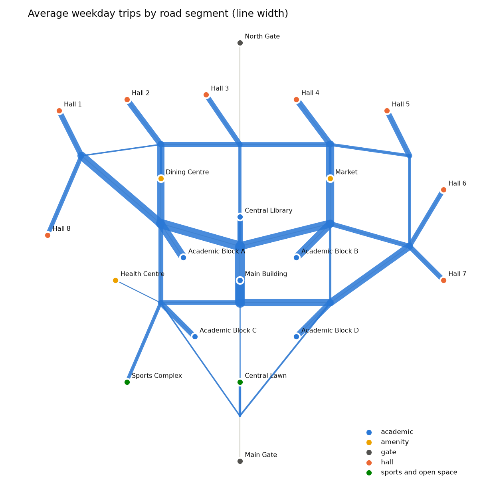
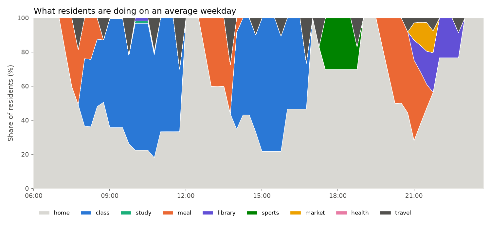
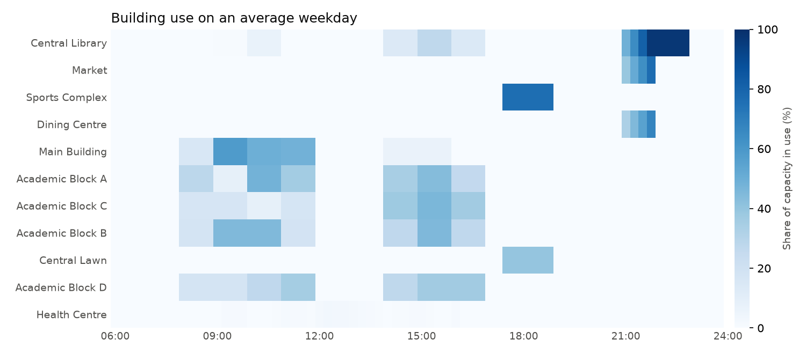
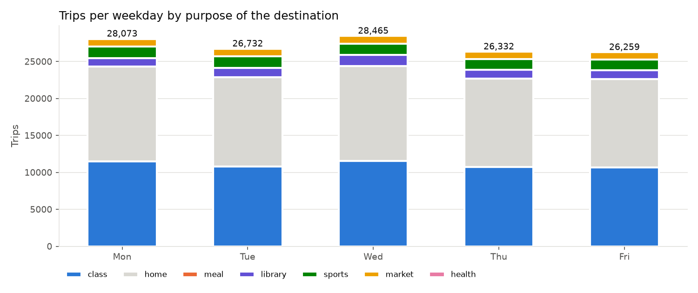

# Campus Digital Twin

[](https://github.com/S-blip-hub/campus-digital-twin/actions/workflows/ci.yml)

An agent-based model of how residents move around a large residential university campus on weekdays. Six spatial layers describe the campus, five weekday timetables drive the agents, and the model reports building occupancy, road-segment use and time use for every 15 minutes from 06:00 to midnight. An interactive web viewer replays the week.



This is an independent Python implementation of the campus mobility model I worked on as a research intern at SRIC, IIT Kharagpur (June–July 2026), where the model was built in GAMA/GAML on the institute's GIS layers. Those layers and the internship code are not part of this repository; the campus here is schematic so the work can be shared openly.

**Stack:** Python (NetworkX, pandas, NumPy, Matplotlib) · SQL (SQLite) · TypeScript viewer (Canvas API, no runtime libraries) · Shell

## How the model works

1. **Spatial layers** (`twin/layers.py`, written to `layers/*.geojson`): roads, residential halls, academic buildings, amenities, sports and open spaces, and gates. The layout follows the structure of a large Indian residential campus (halls on the edge, an academic core, amenities between them). It is schematic, not surveyed.
2. **Population**: one agent per hall bed (5,000 residents), split into five cohorts (UG years 1–4 and PG). About 65% cycle and the rest walk.
3. **Timetables** (`twin/schedules.py`): each cohort has a Monday–Friday class timetable. Agents attend each class with 88% probability.
4. **Activity plans** (`twin/model.py`): around classes, agents eat in their hall mess at staggered times, use short gaps to study, may go to the library during long gaps or at night, play sport in the evening, visit the market or dining centre, or occasionally the health centre.
5. **Routing**: every change of location is a trip on the shortest road path. Travel time depends on mode (1.3 m/s walking, 4 m/s cycling).
6. **Outputs**: building occupancy, time use, trips and road use, plus a SQLite database with analysis queries in `sql/queries.sql`.

## Results for the base week

| Indicator | Value |
|---|---|
| Trips per weekday | about 27,000 (mean length 1.3 km) |
| Mode split | 64% cycle (5.4 min average), 36% walk (16.8 min average) |
| Busiest hour for departures | 11:00–12:00, about 3,300 trips |
| Busiest road segment | Central Library junction to Main Building junction, about 6,400 trips per weekday |
| Sharpest hall outflow | about 430 residents leaving a single hall between 13:45 and 14:00 |

**Building use at its peak**

| Place | Peak | Capacity used |
|---|---|---|
| Central Library | 21:45 | 100% |
| Academic Blocks A–D | 10:00–15:00 | 90–91% |
| Sports Complex | 17:30 | 81% |
| Market | 21:45 | 80% |
| Main Building | 09:00 | 72% |

What the model points to:

- **The library is the bottleneck, not the classrooms.** Academic blocks peak at about 90% of capacity, but the library fills completely after dinner because night study overlaps for every cohort.
- **The lunch-to-afternoon change is the sharpest movement of the day.** Afternoon classes start at 14:00 for most cohorts, so halls empty within 15 minutes and the roads around the academic core carry their highest loads.
- **A few segments carry a large share of the traffic.** Four of the 40 segments, the links between the library, the main building and Academic Block A, take about 19% of all segment crossings. These are the places to widen cycle lanes or add parking first.





## Quick start

```bash
pip install -r requirements.txt
bash scripts/run.sh            # simulate the week, run SQL, draw figures, build the viewer, run tests
open web/index.html         # interactive viewer
```

Individual steps:

```bash
python -m twin.build --scale 1.0 --seed 7   # tables in outputs/, figures in docs/figures/, web/data.js
python -m pytest                             # 9 tests
npm run build                                # compile web/src/viewer.ts to web/js/viewer.js
```

A smaller population (`--scale 0.2`) runs in under a second and is useful while changing timetables.

## Using it for planning questions

The model is meant for "what if" questions. Examples:

- Shift one cohort's afternoon classes to 15:00 in `TIMETABLE` and compare the 13:45 hall outflow.
- Raise `CYCLE_SHARE` and look at walking times and road-segment loads.
- Increase library capacity in `twin/layers.py` or change `LIBRARY_NIGHT` to test a 24-hour reading room.

## Project structure

```
twin/            layers, schedules, agent model, SQLite store, build script
sql/             analysis queries (busiest segments, peak occupancy, mode split, hall outflow)
layers/          six GeoJSON layers
web/             viewer: index.html, style.css, src/viewer.ts, compiled js/, generated data.js
docs/figures/    figures used in this README
scripts/run.sh   one-command pipeline
tests/           pytest suite
```

## Limitations

- The campus layout, capacities, timetables and propensities are illustrative. They are set to be plausible for a residential campus, not calibrated against counts.
- Agents do not interact, so crowding does not change anyone's choices.
- Weekends, visitors, staff and vehicles are not modelled.

## Author

Shrey Singh, B.Arch, Department of Architecture and Regional Planning, IIT Kharagpur.

## License

MIT
